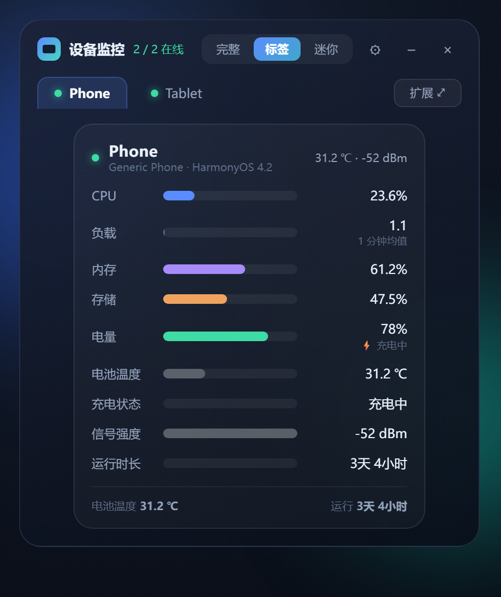
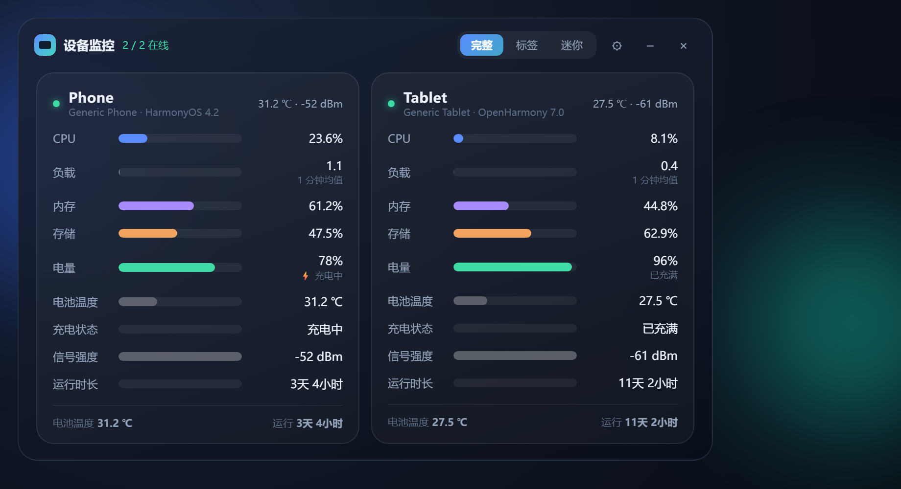
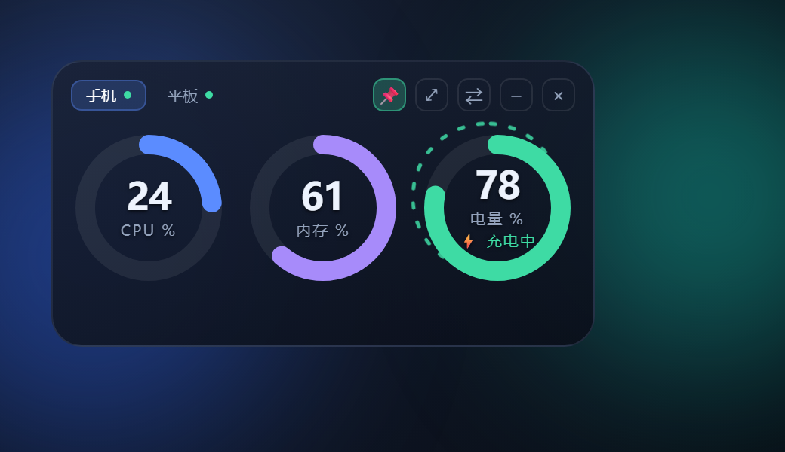

# 鸿蒙设备桌面监控 · Harmony Monitor

> Windows 桌面无边框悬浮窗，**无线**实时查看华为鸿蒙设备（HarmonyOS / OpenHarmony）的
> CPU、内存、存储、电量、温度、Wi-Fi 等运行状态。四种显示模式，最快的指标 1 秒刷新。

**下载**：[Releases](https://github.com/Leslie1168/harmony-monitor/releases/latest) 里的
`harmony-monitor-*-src.zip`（源码 + `hdc` / `adb` 官方二进制，8 MB），解压后按「快速开始」跑即可。
想要 git 方式就直接 clone 本仓库。



---

## 为什么做这个

手机和平板连着充电器跑任务时，想瞄一眼 "现在多少度 / 电量还剩多少 / 内存是不是要满了"，
就得解锁、翻设置。这个工具把三台设备的关键指标钉在桌面上，玻璃卡片、可置顶、
迷你模式下只有 350×190，不占地方。

- **纯本地方案**：只用官方的 `hdc` / `adb` 命令行抓数据，不走账号、不联网、不上传任何数据
- **四种模式互通**：完整面板 / 标签页 / 迷你 / 三台并排，任意两种之间一步切换
- **29 项指标可选**：未勾选的指标不产生采集开销（迷你模式例外，见下文）
- **分档轮询**：fast 1 秒、mid 5 秒、slow 30 秒，按指标重要程度错峰采集

## 界面

| 模式 | 说明 |
|---|---|
| 完整面板 | 多台设备卡片并排 —— `screenshots/full.png` |
| 标签页（默认） | 单卡片 + 顶部设备标签 |
| 迷你 | 350×190 玻璃卡，三个圆环：CPU / 内存 / 电量 —— `screenshots/mini.png` |
| 三台并排 | 多张迷你卡片 + 顶栏 |





迷你模式还有：双击标签改名（≤6 字）、📌 置顶、悬停滑出温度 / Wi-Fi / 存储 / 运行时长详情条、
超标变色（CPU ≥70 黄 ≥90 红）、充电时电量环外圈流动光点、离线整卡变灰但保留最后读数。

## 环境要求

- **Windows 10 / 11**（其它平台未测试，代码里没有平台相关的采集逻辑之外的东西）
- **Python 3.12**（开发与测试环境：3.12.10）
- 鸿蒙设备开启开发者模式 + 无线调试（或 USB 转 TCP）
- 体积提示：界面用 QtWebEngine（Chromium）渲染，打包后安装目录约 **570 MB**、冷启动 1~2 秒——
  这是玻璃质感界面的代价，属已知取舍

## 快速开始

```bash
git clone https://github.com/Leslie1168/harmony-monitor.git
cd harmony-monitor

python -m venv .venv
.venv\Scripts\pip install -r requirements.txt

.venv\Scripts\python main.py
```

首次启动会弹出设置窗口，在「设备」页填 `设备IP:端口` 并选通道：

| 设备系统 | 通道 | 地址形态 |
|---|---|---|
| HarmonyOS 4.x（API 12 及更早） | **adb** | `192.168.1.23:5555` |
| HarmonyOS NEXT / OpenHarmony 7（API 26） | **hdc** | `192.168.1.24:43891` |

配置存在同目录的 `config.json`（首次启动自动生成，可直接改；程序写配置是原子的）。

### 鸿蒙 4.x：先开无线调试

这类设备的开发人员选项里**没有**「无线调试」开关，必须插一次 USB：

1. 数据线连电脑，设备上点「允许 USB 调试」
2. 双击仓库里的 **`开启无线调试.bat`**，脚本对所有 USB 设备执行 `adb tcpip 5555`
3. 看到 `Done` 后拔线，在设置里添加 `设备IP:5555`

> **设备重启后无线连接失效**，需要重新插线跑一次 bat。这是 adb 无线调试的固有限制。

### 鸿蒙 7 / NEXT：直接无线调试

1. 设置 → 关于本机 → 连点「软件版本」7 次，进入开发者模式
2. 设置 → 系统和更新 → 开发人员选项 → 打开「无线调试」，把页面上的 `IP:端口` 填进来

首次连接时设备会弹「允许调试」，必须点允许。

## 监控指标（29 项，5 组）

| 分组 | 可选项 |
|---|---|
| 设备 | 设备名称、型号、系统版本、API 版本、UDID |
| 性能 | CPU 使用率、系统平均负载、CPU 频率、CPU 温度、内存使用率、已用 / 可用内存、存储使用率、剩余存储、进程数 |
| 电池 | 电量、电池温度、电压、电流、充电状态、电池健康、充满剩余时间 |
| 网络 | Wi-Fi 名称、信号强度、链路速率、本机 IP |
| 系统 | 运行时长、屏幕亮度、分辨率 |

两种通道能取到的字段不完全一样，取不到的显示 `—`，不影响其它指标：

| 字段 | hdc（鸿蒙 7） | adb（鸿蒙 4.x） |
|---|---|---|
| CPU 温度 | 受限，通常取不到 | 可读（thermal_zone0） |
| CPU 频率 | 可读（每核） | 取不到 |
| 电流 | 可读 | 取不到 |

## 数据是怎么来的

全部走设备本地的调试通道，一行数据不出局域网：

| 通道 | 主要命令 |
|---|---|
| hdc | `hidumper --cpuusage` / `--mem` / `--storage`、`hidumper -s BatteryService`、`bm get --udid`、`param get` |
| adb | `dumpsys cpuinfo` / `meminfo` / `battery` / `wifi`、`cat /proc/...`、`getprop` |

关键实现细节（踩过的坑都在 `docs/开发文档.md` 里）：

- `hidumper` 的服务正文**只在 TTY 输出**，接管道就丢 → 所有查询全量取回 Python 端解析
- 内存必须用 `MemTotal − MemAvailable`，`free` 报的 used 虚高 97%
- load 是绝对值，要除核数
- 鸿蒙 4.x 的 `hidumper` / sysfs 被 SELinux 限制，改用 `dumpsys`

## 配置文件

```jsonc
{
  "devices": [{"addr": "192.168.1.23:5555", "type": "adb"}],
  "selected": ["cpu", "mem_pct", "battery", "wifi_rssi"],   // 勾选的指标 id
  "window": {"x": 122, "y": 259},
  "appearance": {
    "mode": "tabs",          // full / tabs / mini / mini3
    "topmost": true,
    "opacity": 92,
    "card_width": 330,
    "scale": 100,
    "font": "Microsoft YaHei UI",
    "mini_labels": {"192.168.1.23:5555": "手机"}
  }
}
```

读取时逐字段容错：某个字段损坏只回退该字段，未知字段保留；写入是临时文件 + `os.replace`，
写失败不动原文件。

## 打包成 exe

```bash
.venv\Scripts\pyinstaller --noconfirm --windowed --onedir --name HarmonyMonitor ^
  --distpath dist --workpath build --specpath build ^
  --icon app_harmony.ico ^
  --add-data "app_harmony.ico;." --add-data "app/webui.html;." ^
  --exclude-module tkinter --exclude-module PIL --exclude-module numpy main.py
```

打包后在 `dist/HarmonyMonitor/` 补齐运行时目录：

```bat
mkdir dist\HarmonyMonitor\hdc        && copy hdc\hdc.exe hdc\libusb_shared.dll  dist\HarmonyMonitor\hdc\
mkdir dist\HarmonyMonitor\tools\adb  && copy tools\adb\*.exe tools\adb\*.dll    dist\HarmonyMonitor\tools\adb\
copy config.json app_harmony.ico     dist\HarmonyMonitor\
copy 开启无线调试.bat                 dist\HarmonyMonitor\
```

> 打包前先 `hdc kill`，否则 `hdc.exe` 常驻会锁住 dist 目录。

## 目录结构

```
main.py                 入口：单实例、托盘、配置原子读写、采集线程生命周期
app/overlay.py          薄窗口层：QWebEngineView + QWebChannel 桥
app/webui.html          全部 UI（玻璃卡片、圆环、模式菜单、动画）
app/collectors.py       hdc 后端：指标定义 + 命令 + 解析
app/adb_collectors.py   adb 后端
app/hdc_client.py       hdc / adb 进程封装（可取消、带超时）
app/worker.py           DeviceWorker：分档轮询、重连、失败隔离、日志轮转
app/settings_dialog.py  Qt 设置对话框（设备 / 监控项 / 外观）
hdc/                    鸿蒙调试工具链
tools/adb/              Android platform-tools
开启无线调试.bat         鸿蒙 4.x 设备恢复无线连接用
docs/                   使用说明、开发文档
tests/                  生命周期回归 + 真机冒烟
```

## 测试

```bash
# 生命周期 / 配置回归（不需要设备）
.venv\Scripts\python -B tests\test_lifecycle.py

# 真机冒烟：默认 14 秒，用环境变量指定设备
set HARMONY_DEVICES=adb@192.168.1.23:5555,hdc@192.168.1.24:43891
.venv\Scripts\python -B tests\live_smoke.py
```

## 已知限制

- CPU 频率指标已定义但采集未实现，勾选后显示 `—`
- 鸿蒙 7 上电池「充满剩余时间」实测恒为 0
- 分辨率只有 hdc 通道有，且是逻辑分辨率
- 没有历史曲线、告警阈值、开机自启、局域网自动发现（都在待办里）
- 设置对话框仍是 Qt 原生样式，没有跟着主界面一起 Web 化

## 常见问题

**显示「离线」** —— 设备休眠锁屏后无线调试会断，唤醒即可；程序会持续重连，连续失败才标离线。

**鸿蒙 4.x 重启后连不上** —— 重新插 USB 跑 `开启无线调试.bat`。

**双击图标还是旧样子** —— Windows 图标缓存，注销重登或等一会儿。

**日志** —— 同目录 `monitor.log`（未捕获异常）与 `worker.log`（采集/重连，2 MiB 轮转）。

## English

A Windows desktop overlay that monitors Huawei HarmonyOS / OpenHarmony devices over the
wireless debugging channel (`hdc` for HarmonyOS NEXT / OpenHarmony 7, `adb` for HarmonyOS 4.x).
29 optional metrics across device / performance / battery / network / system, polled in three
tiers (1 s / 5 s / 30 s), rendered as a frameless glass panel by QtWebEngine with four layouts
(full, tabs, mini, mini ×3). Everything stays on the LAN — the app only shells out to the
official `hdc` / `adb` binaries.

```bash
git clone https://github.com/Leslie1168/harmony-monitor.git
cd harmony-monitor
python -m venv .venv && .venv\Scripts\pip install -r requirements.txt
.venv\Scripts\python main.py
```

## License

[MIT](LICENSE)。`hdc/` 与 `tools/adb/` 下的官方二进制各自的许可见 [NOTICE.md](NOTICE.md)。
